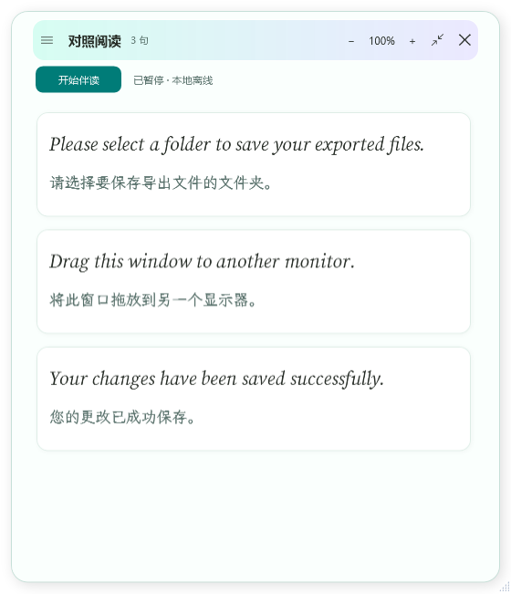

# 界读 · ReadAlong

轻量 Windows 英文应用伴读工具。保留原始英文界面，在独立的小窗口中逐句对照中文，点击英文单词即可收藏释义与例句。



## 直接运行

Windows 10 / 11 x64，需 .NET Framework 4.8。下载或克隆整个仓库，在 PowerShell 中运行：

```powershell
powershell -NoProfile -ExecutionPolicy Bypass -File .\launch.ps1
```

仓库含编译后的 app/界读.exe 和识别组件。第一次启动脚本从字体原作者 GitHub 下载固定版本，逐一校验 SHA-256；之后不重复下载，也不安装系统字体。字体约 27 MB，许可在 Fonts 目录。已有完整便携包时直接双击「界读.exe」，不必运行脚本。

## 功能

- 仅识别当前前台窗口；本机 UI Automation 优先，Windows OCR 补充。
- 主界面直接开始／暂停，识别和翻译时显示扫光。
- 默认每 1 秒检测一次，复用识别进程与 OCR 引擎；重复文字不会打断正在进行的翻译。
- 对照阅读、点击取词、生词本及 CSV 导出；次要操作集中在侧栏。
- 漏斗收缩为可拖动浮窗，收起后继续伴读，支持途中反向。
- 原生英文斜体、中文手写字体、薄荷青与淡紫玻璃层、细窄滚动条。
- 主窗和浮窗可缩放，阅读文字支持 70%–200%，Ctrl + 滚轮调整。

| 快捷键 | 功能 |
| --- | --- |
| Ctrl + Alt + T | 开始／暂停伴读 |
| Ctrl + Alt + M | 收缩／展开 |
| Ctrl + 加号／减号 | 调整阅读字号 |
| Ctrl + 0 | 恢复 100% 字号 |
| Esc | 收起侧栏 |

## 识别速度

在同一个自拟 WPF 测试窗口上，旧版每次新建识别进程约 216–251 ms；新版首次约 239 ms，复用后的五次为 9、7、8、13、8 ms。这只测本机窗口文字读取，不包含检测等待、OCR 或联网翻译，不代表所有应用。

复杂窗口会优先显示可读取的文本；识别卡住时可取消并重建工作进程。默认检测间隔从 3 秒缩短到 1 秒，设置中仍可选择 2、3、5 秒。

## 翻译与隐私

启动默认暂停。识别截图仅在本机内存处理，不上传、不保存；联网翻译只发送待翻译的文字。只保存主动收藏的单词及上下文，普通译文缓存仅保留在本次运行。

默认使用 MyMemory 免费服务，限额可能导致暂停；也可配置自己的 Azure Translator 或 LibreTranslate。受保护窗口、部分游戏或显卡绘制窗口可能不支持识别，可使用「粘贴英文」。更多操作见 [使用说明](docs/使用说明.md)。

个人学习数据保存在 app/data，已由 .gitignore 排除；不要提交自己的单词本、屏幕内容或密钥。字体原始许可已附，设计参考见 [UI 参考](docs/UI美化参考.md)。

## 从源码构建

源码为 C# / WPF，无 NuGet 依赖。构建需 Windows 10 SDK 与 .NET Framework 4.8 参考程序集；直接运行不需要 SDK。

```powershell
powershell -NoProfile -ExecutionPolicy Bypass -File .\build.ps1 -Verify
```

程序生成在 dist/界读，独立自拟测试记录在 qa。默认测试不联网，也不读取个人界面。39 项检查覆盖识别进程复用、取消恢复、输入框排除、重复翻译处理、滚动条拖动、窗口缩放、侧栏、词库、收缩反向及减少动画路径。详见 [验证结果](docs/验证结果.md)。

程序版本：1.7.0。
